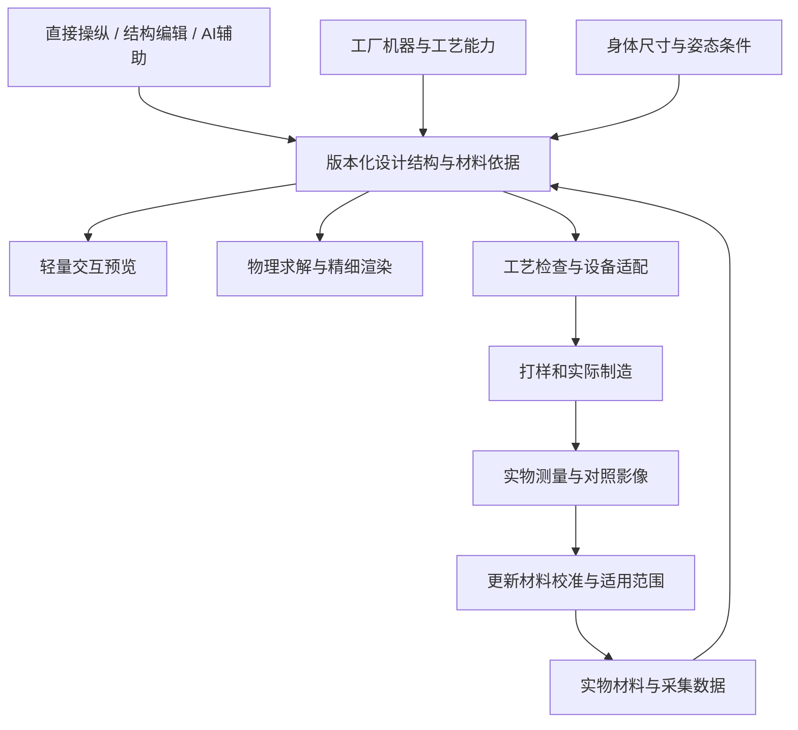

# 丝物：从丝袜验证真实材质、交互设计与生产的基础平台

> 2026-10-15 软件更新：本报告保留资料调研与平台边界。当前统一作品、完整丝袜、材料及设备数据接入见 [README](README.md)；当前实测见 [VERIFICATION](VERIFICATION.md)。已实际执行的 Newton CPU 对照及预编译依赖许可限制见 [BACKEND_COMPARISON](BACKEND_COMPARISON.md)。仍无真实材料样品或工厂机型资料，不声称实物或实机验证。

研究日期：2026-10-15（Asia/Shanghai）
状态：架构建议与实验计划；未进行引擎对比实测、材料测量或工厂打样。
用户已确认：首期丝袜，架构预留其他服装；冲突时优先保证预览与实物一致。
新增硬约束：优先调用可自行部署的开源工具，排除闭源收费引擎/SDK/服务；缺失能力再自研。
研究阶段结束后，用户已授权搭建demo。当前实现小规模结构与物理验证台；材料/制造校准及候选引擎比较仍未完成，原型不能作为真实材质或生产能力证据。

范围修正：用户要求可直接操纵、编辑结构/拓扑并重新物理求解的专业平台。详细内核、候选与原型验收见 [结构、拓扑与物理内核](STRUCTURE_AND_PHYSICS.md)。款式/颜色配置不能作为首期核心交付。

## 结论与决策边界

建议构建一个具备直接结构编辑、物理实验和设备适配能力的服装创作平台。用户能够抓取和拉伸、修改静止轮廓、连接边界、编辑局部针织组织，并在修改后重新求解。每个设计版本都关联同一套结构、材料、身体条件和制造规则；交互预览、精细渲染和工厂资料由这套版本化数据分别生成。这是架构建议，并非现有产品已实现的能力声明。

第一原型应是小规模的结构与物理验证台：织物样片、局部线圈与袜筒三个相连场景。优先比较Newton、SOFA和C-IPC在交互、结构变化及接触方面的适配，另用Knit Sketching研究组织编辑/编译；Blender/Cycles、Mitsuba 3及显示引擎继续承担各自角色。并行取得真实袜样、纱线/工艺资料和合作设备条件，校准物理与外观。所有候选尚未通过本项目实测。

Lonati ORION、Browzwear、商业Style3D SDK、CLO及Unreal路线仅保留作行业参照，移出可采用选型。[S1][S7][S8][S9][S12] 开源工具能覆盖通用渲染、部分仿真与设计表示；本次未找到经验证、直接贯通细旦丝袜材质/穿着/圆机制造的开源整套产品。这是检索结果，不是全网不存在的断言。

## 1. 需求落实为可检验的行为

| 用户需求 | 平台需要具备的能力 | 不能替代它的成果 |
|---|---|---|
| 普通人像游戏一样设计 | 抓取、固定、拉伸、绘制、连接与编辑组织；逐步呈现物理结果并支持撤销 | 仅切换预设款式/颜色，或只提供大量专业参数表单 |
| 严肃结构与拓扑编辑 | 区分部件连接、线圈/纱线拓扑、计算网格和显示；编辑后重建模型与约束 | 删掉三角形就宣称实现真实抽丝/脱圈，或播放预制动画 |
| 材质尽可能真实 | 实物参考、光学采集、尺度正确的织物结构、受拉外观和灯光校准 | 只调整颜色、透明度、光泽 |
| 穿着可信 | 体型/姿态条件、非线性弹性、接触、局部拉伸与边界处理 | 把袜子模型直接缩放到腿上 |
| 预览对应实物 | 设计、材料、工艺、图案坐标与样品证据共用版本 | 保存一张漂亮的图片 |
| 机器自动化制造 | 针对实际设备和工艺的编译、检查、试机与后处理 | 导出通用三维网格或随意命名的 JSON |
| 能扩展其他衣服 | 共用设计身份、材料、身体、作业和验证系统，生产适配按品类分开 | 宣称一个生产文件适用于所有机器 |

优先级已由用户明确：一致性优先。建议交互时允许先出现轻量结果，精细结果随后更新；超出已校准的材料、体型、拉伸或工艺范围时，应标记“需要打样验证”，不能自动沿用既有合格状态。

## 2. 丝袜的真实感为什么难

### 2.1 三种真实性需要分别验收

光学真实解决“看起来像不像”，力学真实解决“拉伸和穿着行为对不对”，生产真实解决“设备和材料是否能做出来”。任何一项都不能单独推导另两项。

丝袜是针织结构。线圈变形会改变孔隙、纱线方向和外观；相关原始研究讨论了力学与微观外观的耦合，以及实时重建变形后的纱线/纤维细节。[S3][S4] 这支持采用变形驱动材质的方向，但不能据此宣称某个论文系统已经准确模拟细旦尼龙/氨纶丝袜。

Denier（D）描述纱线线密度。Wolford 官方词汇表给出 1 den = 9000 米纱线重 1 克。[S2] 所以，不能把 D 数直接定义为透明度百分比；同一个 D 数也不足以唯一确定整件衣物的材料和织法。

建议模型显式考虑下列因素；每项需要实物测量或对照，而不是仅凭观感调参：

- 纤维与包覆结构、线圈组织和局部织密。
- 纵横拉伸、剪切、恢复与循环穿着后的差异。
- 观察/光照方向、局部遮盖率、反射与透射。
- 底层肤色或人台材料对所见颜色的影响。
- 袜口、脚尖、脚跟、接缝及其局部加密。
- 不同距离下的纹理细节，以及缩小时的摩尔纹/闪烁。

### 2.2 “高质量 PBR”是必要工具，不是自动得到正确材料

Three.js 的物理材质已经支持 sheen、各向异性等；文档也说明附加效果有性能成本。[S10] glTF 有对应材质扩展，可携带部分显示参数。[S11] 这些适合作为显示层的基础。

但是，通用表面着色参数并不自动知道真实纱线、线圈孔隙、局部受拉和光散射。建议把通用 PBR 当基线，再以真实袜样判断是否需要针织专用着色、受拉查找表或微结构模型。玻璃式的 transmission 不应被直接当成丝袜孔隙透光模型。

视觉目标建议采用真实产品摄影参考：正常比例的人台或腿部资产、可控摄影灯光、尺度正确的纹理、可信皮肤/人台底层。调研阶段先建立照片与样品参考板，避免以网页风格、AI生成图或主观“更亮更滑”作为材料标准。

## 3. 必须先核对真实生产路线

ATSUGI 的连裤袜企业资料列出：包覆纱、圆筒编织、两筒缝合、染色、蒸汽定型、检验包装。[S6] 这是一个实际厂商的流程实例，各工厂/款式可以不同。它说明整条交付链包含编织以外的工序。

Lonati 的女袜设备资料涉及单针筒、喂纱路数、逐针选针、添纱、特定网眼/提花和针目控制。[S5] 因此设计自由度需要对应合作设备的能力。不能沿用“毛衣横机整件编织”的假设，替代细旦丝袜的设备与工艺确认。

把用户说的“花纹”至少区分为三类：

| 用户所见 | 实际变化 | 需要核对的生产条件 |
|---|---|---|
| 表面图像/文字 | 印花、转印等表面工艺 | 材料适配、伸缩后变形、色牢度、最小细节 |
| 编进袜子的纹样 | 选针、提花、网眼、局部织密等 | 机器/针筒/纱线及组织能力 |
| 袜口与装饰 | 罗口、松紧、蕾丝或其他装配 | 配件供给、连接方法与额外工序 |

这张表是设计分类建议。首期必须由工艺师确认实际可行项，不能把屏幕上可画的任意花纹都开放为可购买选项。

### 行业对照：Lonati ORION（不采用其商业软件）

ORION 官方公开可视化机器编程、工艺规则引擎、三维预览、图形导入和模板检查。[S1] 只研究公开流程以帮助定义自己的工厂适配层，不以采购或调用该商业软件作为方案前提。

尚未确认：我们目标细旦丝袜和机器型号的覆盖范围、开放 API/SDK、生产程序导入导出、第三方平台嵌入、无人批处理及多实例商业授权。宣传中的逼真预览不能替代袜样比较。

## 4. 行业路线比较（商业项目已排除）

| 路线 | 可以提供什么 | 本项目的缺口 | 当前建议 |
|---|---|---|---|
| 浏览器本地 Three.js / WebGL / WebGPU 显示 | 直接交互、参数编辑与材质显示；计算主要在用户设备 | 专用材料、人体与仿真需另建；低端设备细节和性能待测 | 保留为交互候选 |
| Unreal + Pixel Streaming | 服务端 GPU 渲染，通过 WebRTC 给浏览器传图像并收输入 | 会话隔离、GPU时间、网络与编码对细纹理的影响 | 排除，仅作行业原理参考 |
| Style3D Simulator SDK | UE中服装仿真、缓存和参数集成 | 部分公开文档较旧且描述CUDA/NVIDIA；丝袜高弹/薄材和云授权待核 | 排除收费商业SDK |
| Browzwear Open Platform + Server Engine | API与无UI引擎，可用于自动化后端 | 袜子结构支持、外观/物理适配、延迟与商业条件待核 | 排除 |
| CLO API/SDK | 在CLO内的插件开发与工作流自动化 | 公开插件API本身不等于可嵌入的SaaS解算服务 | 排除 |
| Newton/Warp 等开源物理底层 | 可研究自定义弹性、接触、批处理和参数反演 | 不是完整服装产品；不同solver的cloth/自碰撞能力不同 | 优先候选，按具体代码/依赖核验 |
| 研究级针织材质模型 | 高细节针织外观、变形联动和多尺度方法 | 代码/许可、细旦材料验证、工程化与目标硬件性能 | 作为专用材质实验，不能直接当交付承诺 |

对应官方来源：[S7][S8][S9][S10][S12][S13]。上表是本报告的适配判断，不是横向跑分结果。

Style3D 的参数文档允许将拉伸写入顶点色供材质读取，这提供了仿真驱动外观的集成接口线索。[S14] 它没有证明内置了经过校准的丝袜光学模型。其打包文档涉及账号/机器并发限制，应向厂商核对当前云服务授权，而不是按一份个人授权估算平台。[S15]

**建议：开源底座＋丝袜专用模块自研。** 我们掌握产品配方、样品、校准、用户操作与工厂规则；改造可用开源组件，补齐缺少的材质与制造能力。工具选择应可替换，设计数据不能只存在于某个引擎的私有面板里。

### 4.1 开源可复用清单

“可复用”只表示代码/基础功能可得；所有候选都尚未在本项目样品上实测。

| 候选 | 代码与许可 | 可以承担 | 仍需补齐 |
|---|---|---|---|
| Blender / Cycles / EEVEE | Blender开源GPL，第三方组件各有许可；官方区分软件与输出 | 几何/材质母版、参考渲染和物理实验 | 真实丝袜校准、结构内核；5.2实验cloth尚缺自碰撞，详见结构报告 |
| Mitsuba 3 | 官方源码与BSD风格三条款许可可得，附Enhancements段落 | 光传输、材料反演与拟合实验 | 专用模型与真实数据采集 |
| Three.js | MIT，物理材质与自定义着色 | 浏览器工作台和显示 | 受拉织物材质、求解结果映射 |
| Godot | MIT | 原生游戏式工作台、实时交互 | 专用材质/仿真；Web与原生渲染不能默认等价 |
| Newton / Warp | 主线Apache-2.0；运行组件分别核验 | 接触、弹性、批量GPU计算 | 高弹丝袜本构、穿着边界、校准 |
| IPC Toolkit | MIT的接触算法工具箱 | 自研求解器接触模块备选 | 完整服装求解与产品集成 |
| GarmentCode | 主框架MIT，旧仿真fork许可另核 | 未来裁片服装参数化 | 丝袜圆机适配；不能默认旧数据链商用可用 |
| Knit Sketching / knitout | Knit Sketching主仓库MIT，README自称prototype；knitout规范公开 | 编织编辑、组织与编译结构参考 | 工业细旦圆机后端与子模块适配 |
| knitout Kniterate backend | MIT，明确面向Kniterate设备 | 具体后端实现参考 | 不等于Lonati丝袜机兼容 |
| ThunderLoom核心 | MIT的机织材质实现 | 光学模型和接口研究参考 | 不是现成针织丝袜shader；收费渲染器插件排除 |

来源：[S10][S13][S18][S19][S24][S25][S26][S27][S28][S29][S30][S32][S33][S34]。

### 4.2 具体依赖审查结果

- Newton中的`SolverStyle3D`及核函数源码明确Apache-2.0，直接实现投影动力学cloth。它与商业Style3D Simulator SDK不同，前者保留开源候选。[S27] 基础弹性是否适配尼龙/氨纶丝袜仍需验证。
- GarmentCode主仓库MIT不等于整条旧仿真链均满足要求。`NvidiaWarp-GarmentCode` fork README仍写非商业许可，虽备注后续主线许可放宽，不能用该备注替代具体版本许可。[S31]
- 当前Warp主线Apache-2.0，但其README单列libmathdx的NVIDIA软件许可。[S26] 这不是已确认的付费SDK依赖，也不表示全部GPU组件纯开源；固定版本时单列。如要求连GPU运行库也必须开源，则需改筛计算后端。
- Blender与Godot官方给出软件/输出或游戏内容的许可区别，素材、插件及嵌入脚本另核；本次不引入付费插件。[S24][S34]

### 4.3 哪些能力需要自研

优先自研：可编辑产品/线圈结构、静止几何与受力状态的操作语义、结构变化后的模型重建与属性迁移、丝袜非线性材料适配、受拉外观、样品校准、设计/制造映射、目标圆机编译与工艺检查。通用渲染器和适用的物理计算底座优先复用；详细边界见结构报告。

2025实时针织和2026隐式针织研究的公开项目/作者页面，本次未确认到带明确许可的完整可调用实现，暂列算法参考，不能算已经可用的开源组件。[S4][S16] 后续发现实现时，再核验代码与许可。

开源圆机硬件确实存在：Circular Knitic及爱好级circle-knitting项目已公开；未提供经过验证的工业细旦丝袜生产链。[S35] 文档镜像和机器汉化软件包不等于开源编译器。

自研生产适配需要实际设备可得的接口、文件规范和工艺知识。若某设备仅接受商业工具生成的程序，自动化在这条设备路线上仍有接口约束；优先寻找能提供可用接口/规范的合作设备，再决定编译工作。早期人工审阅工艺资料只能算半自动过渡，不能称为机器自动制衣已实现。

软件授权费与硬件/算力、真实样品和打样成本分别记录。AI助手也不应依赖付费云API；其结构化设计接口可以先确定，之后选择代码与权重均符合要求的本地模型。

## 5. 前沿研究应该怎样利用

| 原始研究 | 解决的问题与方法 | 本项目能学什么 | 未覆盖/未验证 |
|---|---|---|---|
| Mechanics-Aware Modeling of Cloth Appearance，TVCG 2019 | 力学引起微结构变化，跨尺度生成外观 | 材质需要随变形更新 | 不是现成丝袜平台 |
| Real-Time Knit Deformation and Rendering，SIGGRAPH 2025 | 由动画stitch mesh恢复局部纱线并进行纤维级实时渲染 | 全局形态与局部纤维分层计算 | 项目页一例为RTX3090；不能推广到手机或细旦丝袜 |
| A Texture-Free Multi-Scale Model for Surface-Based Rendering of Knitted Fabrics，CGF 2026 | 参数化曲线隐式表达针织结构，避免全量显式纱线 | 近看/远看的统一材质和细节层级 | 论文算法、可集成实现及制造正确性分开 |
| Predicting Fabric Appearance Through Thread Scattering and Inversion，SIGGRAPH 2025 | 多视角采集真实线材并反演光散射，预测机织外观 | 从真实材料出发校准，而非只靠主观调参 | 原工作以机织为主，不能直接外推针织丝袜 |

来源：[S3][S4][S16][S17]。本次主要核验原始项目页、公开摘要和出版元数据，未复现实验。2026论文的Eurographics页面访问受限，已通过Wiley DOI页核验，未声称阅读全文。

值得试验的工程折中：全局用可校准的薄弹性面/袜筒模型求解；局部材质读取纵横拉伸和剪切，更新线圈尺寸、覆盖率与方向；精细参考画面采用更细的纱线表示。是否足够真实，由样品对照决定。无须预设每一帧都完整模拟每根纤维。

## 6. 核心数据：一份设计，多种结果

建议基础对象：

| 对象 | 最少应记录的内容 |
|---|---|
| 材料记录 | 供应商/批次、纤维/包覆、线密度、染整、采集条件、光学与力学数据 |
| 产品结构 | 部件/开口/接缝、静止轮廓、组织与线圈/纱线关系、区域方向/材料、形成方法；计算网格为派生产物 |
| 身体/穿着条件 | 身体或人台版本、尺寸、姿态、穿着边界；与同意授权的原始数据分开存放 |
| 制造配方 | 机型能力、原生程序版本、喂纱/针目/组织规则及后续缝合染整要求 |
| 校准记录 | 样品编号、设备和灯光、拉伸条件、拟合方法、误差、通过与未通过范围 |
| 设计版本 | 上述对象的确定引用、用户修改、软件/求解器版本，避免素材更新悄悄改变旧订单 |
| 生成作业 | 输入版本、质量模式、状态、产物与实际耗时，可重跑和对照 |

glTF可作为浏览器显示资产格式，Blender/工业工具原生文件可保留为编辑母版；工厂仍使用对应设备/工艺文件。它们是由同一配方生成的不同产物，不应硬塞进一个“万能文件”。glTF材质扩展描述显示模型，不是针织程序。[S11]

首期服务形态建议为单个应用服务、版本数据库、对象存储和异步作业队列；GPU求解/渲染以独立作业运行。只有在并发、业务或运维证据要求时再拆分。渲染缓存按设计版本与条件索引；高质量作业完成前，界面应明确当前预览质量，不能把旧版本结果当新设计展示。

### 向其他服装扩展

共用创作历史、材料、身体、渲染作业、资产和验证记录。分别增加：丝袜圆机适配、毛衣横机适配、衬衫/裙子的裁片缝合适配。

GarmentCode是可参考的模块化参数纸样框架，适合研究未来裁片服装。[S18] knitout是机器无关低级编织指令的研究格式。[S19] 本次没有找到经过验证的Lonati细旦圆机knitout后端，不能用格式名称替代机器适配工作。

人体资产也要区分固定可用身体与可参数化生成模型。SMPL官方对SMPL-Body和SMPL-Model给出不同许可，后者的商业使用需要单独授权。[S20] 首期可采用明确商用来源的人台/腿部资产，以实测尺寸校准，不必立刻做照片量体。

## 7. AI 的职责与约束

建议AI操作上述结构化设计对象：理解“将这一块改为网眼组织”“连接这两条边界”“让脚踝附近更贴合”等意图，产生可检查、可撤销的结构或参数修改，解释物理及工艺依据。变化必须经过相应结构和规则检查，再交给仿真/制造流程。AI不负责凭图像想象出受力结果。

图像生成可用于灵感探索，但生成图不自动成为确认款。若用于订单沟通，应回到可编辑结构和实际材料后再渲染；不能用生成图补掉接缝、改写图案或隐藏工艺不支持之处。

制造状态建议分为：可探索、结构检查通过、样品验证通过、允许生产。AI不能自行把未经样品验证的新材料或组织组合提升为允许生产。首期机器程序由工艺师审阅，自动化先覆盖已有工艺范围内的确定修改。

## 8. 先做哪几个实验

以下是建议的实验规模与门槛方向，不是行业统一标准或已经通过的结果。

### 实验 A：建立可校准的真实样品组

选择一家工厂、一种袜型和一个可得纱线体系。取得少量有明确材料/工艺记录的袜样，优先覆盖几种有意义的织密或外观差异；每组保留同工艺重复样品，检查批次变化。先核实单件/小批量、调机、换纱染整和样品成本。

固定摄影和测量条件，记录不同方向、若干纵横拉伸组合、不同底层肤色/人台颜色，以及正面/侧面/背光效果。拉伸范围由袜样实际可穿范围确定，不任意套用统一百分比。

Vizoo光学采集和Browzwear FAB力学测量仅作行业数据类型参照。[S21][S22] 首期自建可控摄影/拉伸采集，使用开源图像和数值工具分析；精度必须验证，不将商业扫描软件作为必需依赖。平铺扫描不自动包含穿着状态的数据。

### 实验 B：同样品比较三条外观路线

使用完全相同的几何、灯光和材料证据比较：通用PBR基线、受拉驱动的专用材质、离线精细参考渲染。检查颜色、透光变化、高光方向/宽度、花纹比例、近远景一致性。离线结果同样须与实物比较，不能自己当作真实值。

把若干灯光/角度/拉伸条件留出，不参与调参；测试时再使用，避免只在调参画面里好看。审美偏好与实物误差分别收集。

### 实验 C：用同一袜样比较仿真后端

以Newton的VBD和开源SolverStyle3D等为交互候选，SOFA为动态结构候选，C-IPC为严肃接触候选；同题比较后再决定采用哪些组件。先检查样片固定/拉伸/释放及切开/连接后的状态，再检查袜筒穿着、局部组织变化、脚踝/膝部接触、稳定性和穿插。检验材料方向、约束与质量在编辑后是否正确，进行网格/时间步/迭代敏感性检查。记录适用体型与姿态，滑落和舒适性仍需试穿。具体实验见结构报告。

### 实验 D：验证部署而非只比较截图

在目标电脑和手机上测Three.js浏览器交互的延迟、加载、帧率及细纹理闪烁；比较Godot原生候选时保持材料与灯光相同。Godot 4.5公开Web文档描述Compatibility/WebGL2路径，不能默认等于原生Forward+质量，实际版本需再次核对。[S36] 精细确认图可由自部署Blender/Cycles异步生成。是否需要GPU交互流服务，在本地路线实测后再评估开源实现。

### 实验 E：同一设计版本实际打样

由确定设计配方生成预览和工厂资料，工艺师审阅，实际制作；回收工艺更改、用料和成品记录。新改动须产生新版本。比较时使用没有参与材料拟合的新样品/批次，确认误差和失败情况。

结构与物理操作应从第一原型就存在，材料与制造验证并行推进。随后用这些操作构成普通人能学会的连续创作流程。首期应同时展示“确实改变结构并重新求解”和“经过验证的设计与实际袜样对应”，不能用增加选项数量替代核心能力。

## 9. 原型推进门槛

| 阶段 | 可交付证据 | 进入下一阶段前需要成立的条件 |
|---|---|---|
| 结构与物理原型 | 样片/线圈/袜筒的直接交互、结构修改与重算记录 | 编辑语义正确、状态迁移可检查、数值与实际交互结果可复现 |
| 材料原型 | 同袜样的照片/测量/渲染对照 | 在留出条件下达到预先约定的外观误差 |
| 穿着原型 | 固定体型/姿态范围下的仿真与实物比较 | 长度、贴合、局部外观、稳定性可信 |
| 用户原型 | 普通人完成一次真实范围内的创作 | 操作可理解、结果来源明确、愿意继续使用 |
| 制造原型 | 预览版本→工厂资料→实际袜样的完整记录 | 无未记录的人工改款，成本与交期可解释 |
| 自动化扩展 | 已验证范围的重复生产记录 | 换材料/组织/设备时重新验证，不沿用旧结论 |

具体阈值应在得到样品和候选引擎后预先约定。不能凭本次桌面研究给出“95%还原”或某个统一材料精度数字。

平台持续成本包括自部署硬件/托管、材料数字化、计算作业、专用模块研发、工艺编程、打样返工、换线换纱染整和客服。闭源收费引擎许可及付费云API不进入方案。建议分别记录每次设计会话、每次精细预览、每个新增工艺和每个真实订单的成本；尚未得到打样报价，不编造总预算或精确周期。

责任至少覆盖三类能力：图形/材质与技术美术、丝袜纺织工艺/打样、软件与作业系统整合。一个人可以兼任，合作工厂也可承担工艺部分；不能用通用前端能力替代纺织专业输入。

## 10. 关键反证、未决事项与下一次讨论

- 丝袜结构看似简单，但细薄、高弹、透肤和肤色耦合使材料校准敏感；选择它是产品切入，不代表它是最低技术难度。
- ORION等系统已覆盖部分编程/预览，因此核心机会需要通过普通人创作体验与实际交付验证，不能仅凭“AI+3D”宣称空白市场。
- 商业仿真软件有现成接口，但通用服装示例不证明细旦丝袜准确；反过来，论文展示实时针织也不证明支持工厂程序。
- 用户对玩法感兴趣与愿意为实物付费要分别观察；“噱头”不能代替材质、合身与交付质量。
- 屏幕、照明、底层肤色和批次都会影响观察结果。一致性应声明适用条件，并以布样/袜样作为锚点，不能承诺所有设备所有灯光完全一致。
- 工厂机器、接口、商业授权、真实样品和目标设备尚未取得；它们决定最终选型。本报告提出候选与验证方案，不声称已完成工程验证。

下一工程阶段应按结构报告验证样片、线圈与袜筒的核心操作，并取得真实样品、设备条件和视觉参考以校准结果。先比较核心底座，再决定工作台实现；不沿用早期颜色/款式配置器作为产品架构。

## 11. 来源与研究方法

采用官方产品/开发文档、设备厂商资料、原始研究项目页、作者提交摘要和官方开源仓库。按制造、材料采集、渲染、形变、部署、结构表示分别检索；检查是否把毛衣横机泛化为丝袜圆机、机织泛化为针织、服务器API泛化为自由商业嵌入、研究演示泛化为可生产产品。不是PRISMA系统综述，也未统计覆盖整个市场。

来源等级说明：官方资料可以确认公开接口/流程，但产品效果和成本仍属于厂商说明；原始论文可以确认方法与特定实验报告，不能替代我们的产品实测；本报告的架构、实验与阶段安排是建议。

| 编号 | 一手来源 | 本次使用范围与限制 |
|---|---|---|
| S1 | [Lonati ORION](https://lonati.com/en/orion/) | 官方功能页；未试用、接口和丝袜覆盖待确认 |
| S2 | [Wolford 2025年报词汇表](https://company.wolford.com/wp-content/uploads/2026/06/20260424-02_DE_2025_Annual_Report_FINAL.pdf) | denier定义；未引用投资或经营结论 |
| S3 | [Mechanics-Aware Modeling of Cloth Appearance](https://arxiv.org/abs/1904.11116) | 作者摘要、TVCG出版信息；未复现 |
| S4 | [Real-Time Knit Deformation and Rendering](https://kuiwuchn.github.io/rtstitch.html) | 作者项目页与特定硬件实验描述；非丝袜基准 |
| S5 | [Lonati LB04YJ 设备说明](https://www.lonati.com/uploads/2023-1-31/LB04YJ-ENG.pdf) | 厂商机器能力；非已选定机型 |
| S6 | [ATSUGI 企业资料：一贯生产流程](https://www.atsugi.co.jp/assets/img/company/atsugi_CP.pdf) | 厂商实际流程示例；不同款式可不同 |
| S7 | [Style3D Simulator 简介](https://help.style3d.com/simulator/zh/1e97) | UE接口和CUDA路径；页面较旧，最新范围待核 |
| S8 | [Browzwear Open Platform / Server Engine](https://help.browzwear.com/en/articles/13065059-open-platform-and-vstitcher-server-engine) | API/无UI与单独授权；效果未测 |
| S9 | [CLO API文档](https://developer.clo3d.com/py-modindex.html) | 插件API的公开定位；未核实独立服务器商务方案 |
| S10 | [Three.js MeshPhysicalMaterial](https://threejs.org/docs/pages/MeshPhysicalMaterial.html) | 显示能力和成本说明；不是实物校准结果 |
| S11 | [Khronos glTF sheen 扩展](https://github.com/KhronosGroup/glTF/blob/main/extensions/2.0/Khronos/KHR_materials_sheen/README.md) | 材质交换标准；不包含制造语义 |
| S12 | [Epic Pixel Streaming Overview](https://dev.epicgames.com/documentation/unreal-engine/overview-of-pixel-streaming-in-unreal-engine) | 远程渲染/WebRTC原理；未做网络测试 |
| S13 | [Newton求解器能力表](https://github.com/newton-physics/newton/blob/main/docs/solvers/index.rst) | cloth/自碰撞能力差异；未运行、未选定 |
| S14 | [Style3D Simulation Parameters](https://help.style3d.com/simulator/en/e2ae/4c5e) | strain-to-vertex-color接口线索 |
| S15 | [Style3D Package Project](https://help.style3d.com/simulator/en/c985) | 打包/账号并发文档；云商务条款需当前确认 |
| S16 | [A Texture-Free Multi-Scale Model…](https://doi.org/10.1111/cgf.70356) | CGF 2026题目、作者、公开摘要与出版元数据；未复现 |
| S17 | [Predicting Fabric Appearance Through Thread Scattering and Inversion](https://zhaoyangzh.github.io/publication/2025_siggraph_fabric/) | 作者项目摘要；机织适用范围需保留 |
| S18 | [GarmentCode](https://github.com/maria-korosteleva/GarmentCode) | 官方仓库/模块化纸样定位；非圆机编译器 |
| S19 | [knitout规范](https://textiles-lab.github.io/knitout/knitout.html) | 机器无关指令与针床语义；未找到已验证Lonati后端 |
| S20 | [SMPL-Body](https://smpl.is.tue.mpg.de/bodylicense.html)、[SMPL-Model](https://smpl.is.tue.mpg.de/modellicense.html) | 官方许可差别；具体资产须核其实际授权 |
| S21 | [Vizoo xTex](https://www.vizoo3d.com/xtex-hardware/) | 光学PBR采集功能；未采购/扫描样本 |
| S22 | [Browzwear FAB](https://help.browzwear.com/en/articles/13065916-fabric-analyzer) | 力学曲线/参数采集；细旦袜样测量适配待核 |
| S23 | [Dressmaker 开发者回复](https://www.reddit.com/r/CozyGamers/comments/1wmvggw/comment/pbf4748/) | 玩法参考的物理简化边界；未亲自试玩 |
| S24 | [Blender许可](https://www.blender.org/about/license/)、[官方FAQ](https://www.blender.org/support/faq/) | 软件与输出、内部使用和分发说明；素材/插件分别核 |
| S25 | [Mitsuba 3](https://github.com/mitsuba-renderer/mitsuba3)、[LICENSE](https://github.com/mitsuba-renderer/mitsuba3/blob/master/LICENSE) | 开源渲染/反演与许可原文；未运行 |
| S26 | [Warp主线README](https://github.com/NVIDIA/warp/blob/main/README.md) | Apache主许可及libmathdx单独许可；不同于旧fork |
| S27 | [Newton公开SolverStyle3D](https://github.com/newton-physics/newton/blob/main/newton/_src/solvers/style3d/solver_style3d.py)、[核函数](https://raw.githubusercontent.com/newton-physics/newton/main/newton/_src/solvers/style3d/kernels.py) | Apache头、内部实现和Warp依赖；不是收费SDK |
| S28 | [Three.js LICENSE](https://raw.githubusercontent.com/mrdoob/three.js/dev/LICENSE) | MIT主许可原文 |
| S29 | [Knit Sketching](https://github.com/xionluhnis/knitsketching)、[LICENSE](https://raw.githubusercontent.com/xionluhnis/knitsketching/master/LICENSE) | MIT主许可、原型定位；子模块待固定版本核验 |
| S30 | [Kniterate backend](https://github.com/textiles-lab/knitout-backend-kniterate)、[LICENSE](https://raw.githubusercontent.com/textiles-lab/knitout-backend-kniterate/master/LICENSE) | MIT及目标设备；非工业细旦圆机后端 |
| S31 | [NvidiaWarp-GarmentCode旧fork](https://github.com/maria-korosteleva/NvidiaWarp-GarmentCode/blob/main/README.md) | 非商业许可说明与后续主线备注；暂排除这条旧仿真链 |
| S32 | [IPC Toolkit LICENSE](https://github.com/ipc-sim/ipc-toolkit/blob/main/LICENSE) | MIT接触模块；不是完整服装系统 |
| S33 | [ThunderLoom](https://github.com/Thunderloom/ThunderLoom) | MIT机织核心库；针织及收费插件不外推 |
| S34 | [Godot许可](https://godotengine.org/license/) | MIT主许可、游戏内容与第三方组件说明 |
| S35 | [Circular Knitic](https://github.com/var-mar/circular_knitic)、[circle-knitting](https://github.com/fashiontec/circle-knitting) | 开源圆机项目确实存在；未证实工业细旦丝袜能力 |
| S36 | [Godot 4.5 Web导出](https://docs.godotengine.org/en/4.5/tutorials/export/exporting_for_web.html) | 指定版本Compatibility/WebGL2限制；后续版本需重核 |

研究由AI辅助检索、核验与综合；无外部模型复核、无专家访谈、无工厂或候选引擎实测。主要结论限定于一手公开证据与明确标注的工程建议。

[S1]: https://lonati.com/en/orion/
[S2]: https://company.wolford.com/wp-content/uploads/2026/06/20260424-02_DE_2025_Annual_Report_FINAL.pdf
[S3]: https://arxiv.org/abs/1904.11116
[S4]: https://kuiwuchn.github.io/rtstitch.html
[S5]: https://www.lonati.com/uploads/2023-1-31/LB04YJ-ENG.pdf
[S6]: https://www.atsugi.co.jp/assets/img/company/atsugi_CP.pdf
[S7]: https://help.style3d.com/simulator/zh/1e97
[S8]: https://help.browzwear.com/en/articles/13065059-open-platform-and-vstitcher-server-engine
[S9]: https://developer.clo3d.com/py-modindex.html
[S10]: https://threejs.org/docs/pages/MeshPhysicalMaterial.html
[S11]: https://github.com/KhronosGroup/glTF/blob/main/extensions/2.0/Khronos/KHR_materials_sheen/README.md
[S12]: https://dev.epicgames.com/documentation/unreal-engine/overview-of-pixel-streaming-in-unreal-engine
[S13]: https://github.com/newton-physics/newton/blob/main/docs/solvers/index.rst
[S14]: https://help.style3d.com/simulator/en/e2ae/4c5e
[S15]: https://help.style3d.com/simulator/en/c985
[S16]: https://doi.org/10.1111/cgf.70356
[S17]: https://zhaoyangzh.github.io/publication/2025_siggraph_fabric/
[S18]: https://github.com/maria-korosteleva/GarmentCode
[S19]: https://textiles-lab.github.io/knitout/knitout.html
[S20]: https://smpl.is.tue.mpg.de/modellicense.html
[S21]: https://www.vizoo3d.com/xtex-hardware/
[S22]: https://help.browzwear.com/en/articles/13065916-fabric-analyzer
[S23]: https://www.reddit.com/r/CozyGamers/comments/1wmvggw/comment/pbf4748/
[S24]: https://www.blender.org/support/faq/
[S25]: https://github.com/mitsuba-renderer/mitsuba3/blob/master/LICENSE
[S26]: https://github.com/NVIDIA/warp/blob/main/README.md
[S27]: https://github.com/newton-physics/newton/blob/main/newton/_src/solvers/style3d/solver_style3d.py
[S28]: https://raw.githubusercontent.com/mrdoob/three.js/dev/LICENSE
[S29]: https://github.com/xionluhnis/knitsketching
[S30]: https://github.com/textiles-lab/knitout-backend-kniterate
[S31]: https://github.com/maria-korosteleva/NvidiaWarp-GarmentCode/blob/main/README.md
[S32]: https://github.com/ipc-sim/ipc-toolkit/blob/main/LICENSE
[S33]: https://github.com/Thunderloom/ThunderLoom
[S34]: https://godotengine.org/license/
[S35]: https://github.com/var-mar/circular_knitic
[S36]: https://docs.godotengine.org/en/4.5/tutorials/export/exporting_for_web.html
