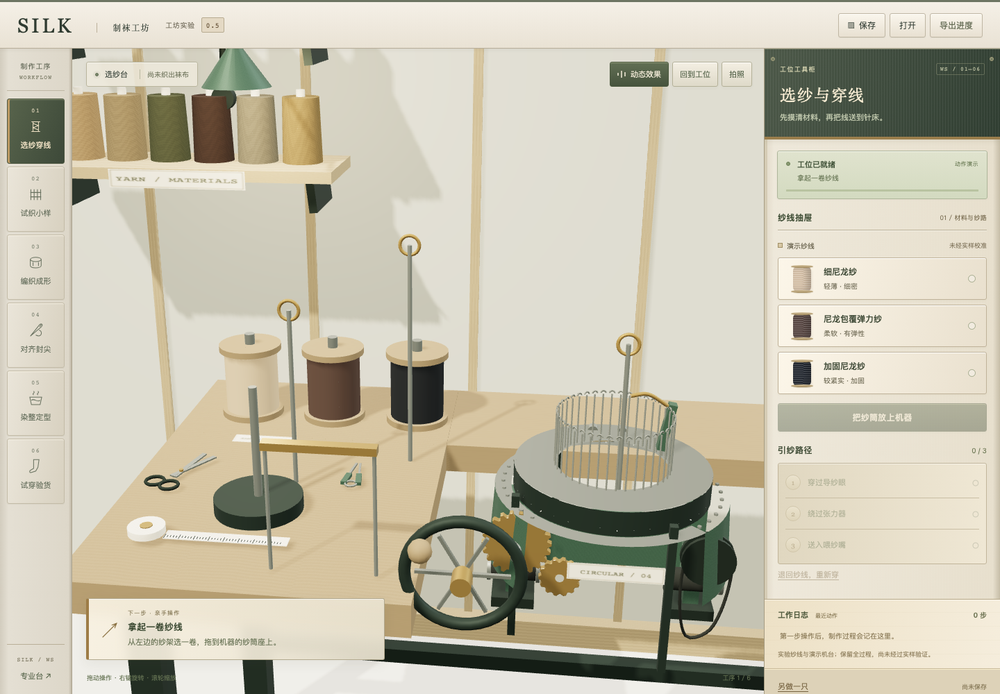
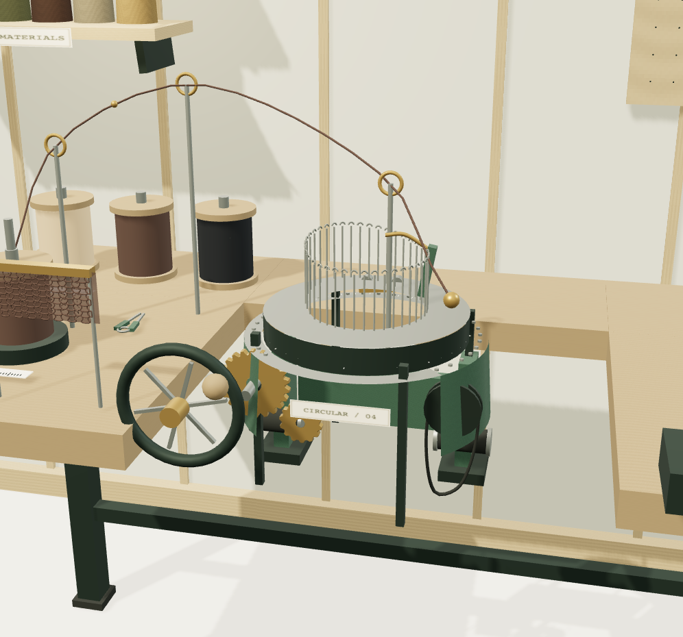
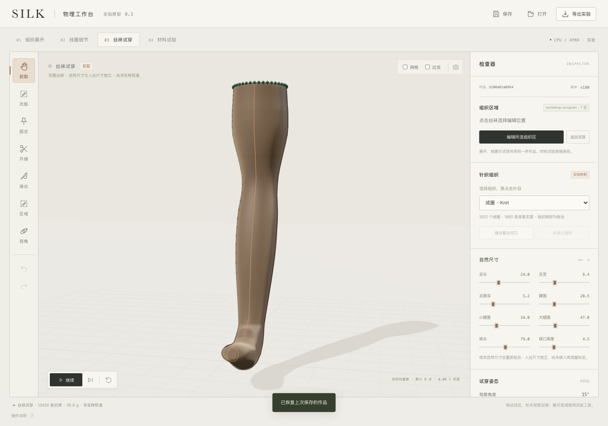

# SILK

**Make a virtual stocking, starting with a spool of yarn.**

SILK is an open-source 3D hosiery workshop prototype. Thread the machine, knit and pull a sample, draw your stitches, make a blank, sew the toe, dye and board it, then inspect your piece on a leg form. A mistake has a repair path: unravel knitted rows or unpick a crooked seam and try again.

[Make your first stocking](#make-your-first-stocking) · [中文](README.md) · [Step-by-step guide, in Chinese](docs/GETTING_STARTED.md)

> **Experimental version 0.5.1.** You are making a digital piece. Yarn responses and machine parameters are uncalibrated. Physical garment agreement and industrial production remain unverified. **The application interface is currently Chinese.**



## Make your first stocking

You need Python 3 and a WebGL-capable browser. Desktop gives you more space for stitch editing; touch controls and tool buttons are also available.

```bash
git clone https://github.com/rzr002/silk-studio.git
cd silk-studio
python3 scripts/start.py
```

Open **[http://127.0.0.1:4197](http://127.0.0.1:4197)** and start at the yarn station. The workshop uses bundled resources and runs without npm installation or paid APIs.

## Watch your decisions become a piece

| What you do | What changes |
|---|---|
| Mount a spool and thread the guide, tensioner and feeder | The yarn path connects in order before sampling can begin |
| Turn the handwheel, pull a sample and adjust loop length | Keep trial samples and synthetic force records to compare settings |
| Set natural dimensions and paint knit, tuck or miss cells | The blank grows from cuff to toe; editing a made row requires unraveling |
| Align the toe edges and operate the sewing pedal | A misaligned seam blocks finishing until you unpick and realign it |
| Dye, board, smooth the cuff, leg and foot, then set | Inspect the same piece on a leg form, name it and keep it |



Gears, needles, sewing parts, dye and steam move with the action. Station changes have camera transitions. The renderer stops drawing after motion settles. The animation control follows your system's reduced-motion preference on first use.

Save keeps progress in your browser. JSON export carries the project and its making record; PNG capture keeps the current view. Restored progress opens with knitting paused.

## A second workspace for structure and physics

Send a finished piece to the professional lab with its design ID, revision and making origin. The lab exposes natural-shape editing, stitch regions, cuts, seams, material data and hypothetical machine-rule checks. Open it directly at **[/lab.html](http://127.0.0.1:4197/lab.html)**.



The lab includes browser XPBD and an optional local IPC numerical reference. See the [technical guide, in Chinese](docs/TECHNICAL_GUIDE.md) for implementation details.

## Before you start

**Do I need textile experience?** Follow the current station's next action. Scene gestures have corresponding tool buttons. Keep the default dimensions and plain knit for a first piece.

**Can it produce real hosiery?** Exports contain a digital project and experimental technical data. The 48 visual course groups and assumed needle counts are interaction groupings. `nativeProgram` remains `null`; measured materials, machine compilation and physical trials are unfinished.

**Does it use AI?** The current prototype uses direct manipulation and controls. No AI model or cloud AI service is integrated.

**What has been validated?** Version 0.5.1 passed 312 of 314 module tests in a clean copy; two XPBD whole-stocking gates still fail. Four browser checks passed for file loading, rejection of modified geometry and lab handoff. The earlier 0.5 record passed 77 making/display checks. One specified IPC reference case advanced 1.333 simulated seconds in about 52.7 minutes; it does not validate every piece or physical garment agreement. See [validation notes](docs/VALIDATION.md).

**Why might rendering be slow?** WebGL speed depends on hardware and the graphics backend; software rendering can be slow. Reduce animation if needed. Workshop motion and the lab's numerical reference are separate systems.

## Contribute

Reproducible issues and contributions are welcome. Useful work includes measured yarn and swatch data, independent contact regressions, machine rules and clearer making feedback. Support physics and manufacturing claims with inputs, validation methods and failure cases.

Development tests use Node.js. Browser tests additionally need Playwright and Chromium; commands are in the [technical guide](docs/TECHNICAL_GUIDE.md).

Released under the [MIT license](LICENSE). Third-party notices are retained separately.
