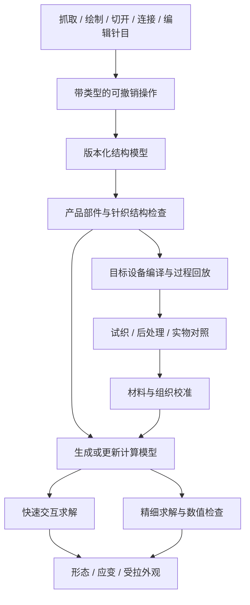

# 专业服装创作平台：结构、拓扑与物理内核

日期：2026-10-15。版本：0.3。状态：结构与物理模块已有可运行实现和 Node 行为验证；Newton/Warp 已在本机隔离环境真实运行对照。仍没有袜样、工厂、材料实测或机器试织，也没有完成完整依赖许可准入。浏览器交互和发布结果以最终验收记录为准。本文保留长期需求与候选调研，同时区分当前软件能力和待验证目标。

## 0. 0.3 已实现的基础模块

| 模块 | 已实现及验证的行为 | 当前边界 |
|---|---|---|
| `design-document.mjs` | 同一设计 ID/revision 保存尺寸、人体条件、多个组织区域和带类型操作；组织重建重放自然轮廓、固定、材料、开缝与缝合，并按稳定顶点 ID 迁移动态状态 | 仍是小规模结构模型；不是任意服装或纱线拓扑编译器 |
| `garment-geometry.mjs` / `contact.mjs` | 具有闭合脚尖、脚部、脚跟、腿部和袜口的单腿袜型；自然尺寸与身体尺寸分开；可初始化穿着状态，并与同一人体三角面几何接触 | 初始化到人体附近后求解，不是袜子从脚尖穿过脚跟的完整穿着路径；人台是几何代理 |
| `physics.mjs` | 米/秒/千克单位的 CPU XPBD，固定、抓取、释放、方向局部参数、重力、接触摩擦、约束反力估计；非线性材料曲线改变真实受力响应 | 方向拉伸仍为离散边模型；弯曲仍使用两跳距离近似；没有纱线接触、粘弹性或滞回验证 |
| `topology.mjs` | `incisionSegmentUV` 沿网格边近似画线，通过复制断开的顶点扇形成新边界；不删面、不减面积或质量；保留自然状态、局部参数与原顶点 ID | 切口路径有网格分辨率误差；不是自动裂纹扩展、抽丝或脱圈预测 |
| 段缝合 | `sewPaths` 按自然弧长匹配两段连续边界并建立整组约束；`unstitch` 按缝组拆除；切口和缝组可保存恢复 | 没有缝线材料、针距与实际缝纫工艺标定 |
| `collision.mjs` | 空间哈希非相邻顶点—三角形自接触、有限厚度、逆质量反力；材料近邻按自然网格路径距离排除，避免细网格假膨胀；运动布点对静止面的运动段检测 | 默认模式**不覆盖运动三角形 CCD、边—边 CCD 或全局无交叠保证**；运动面和 broadphase 截断有显式统计；实验人体顶点—运动布面接口见下文 |
| `edge-contact.mjs` | 实验线性边—边三次共面根、来向反力、逆质量响应与扫掠哈希；单独覆盖端点测试漏掉的中部穿越 | 共面持续重叠、平行退化等明确 unsupported；未通过整袜强门禁，默认关闭 |
| `scripts/ipc-cloth.py` | 使用原生 IPC Toolkit 的无会话隐式参考求解：真实质量惯性、线性弹簧势能/导数、barrier、稀疏 Newton、CCD/Armijo 和原子提交；完整人体目标用可行 continuation 预热；固定接触参考后的整袜静态及实际 UI 0→55° 路径已通过本轮强门禁 | 非线性材料、摩擦和移动抓取仍未接；仅验证所声明的数值配置与加载路径，没有实测标定或长期稳定验证 |
| `material-data.mjs` | 导入声明来源、方向、尺寸、周期和留出行的 CSV；按样片宽度归一化为 N/m，拟合方向曲线，独立记录拟合/留出检查 | synthetic 永不升级为实测；曲线留出通过也不代表整件力学或制造验证 |
| `deformation.mjs` | 从当前与自然三角材料坐标计算经纬伸长、面积伸长和剪切角；显示随形变变化，可使用带来源的透射率 LUT | 默认外观是几何假设，尚无袜样/灯光/视角留出对照 |
| `manufacturing.mjs` | 可导入设备能力与来源声明，检查针位、喂纱路、颜色、浮线、边界和实验组织，导出固定设计版本的技术数据包 | 原生机器程序始终为空；没有真实设备闭环，未通过项目保持 blocked/unverified |

### 材料曲线的物理含义

`setMaterialLaw(profile)` 的 warp/weft 使用边工程应变 `(L−L0)/L0`。CSV 力先由测量宽度归一化为张力 N/m，再乘自然面面积与边长估计的 tributary width（m），得到离散力 N。非线性求解使用曲线力与切线的一致 Newton/XPBD 残差，局部刚度倍率继续影响物理响应；缺失的方向保留原线性模型。

剪切曲线采用工程量 `γ = tan(θ自然 − θ当前)`，不是对角线伸长，也不是直接把弧度当 CSV strain。三角材料坐标给出夹角及解析梯度，面积乘 N/m 曲线构成剪切能量与广义力。显示层仍保存剪切角（radians），匹配 shear 光学 LUT 时转换为 `abs(tan(angle))`。接近 ±84° 的角变化有数值截断，必须视作超出有效范围；未对极端塌缩形态作精度承诺。

`setStrainLimit(value)` 保存一个独立数值伸长限制，默认工程应变 2（长度比 3），`null` 关闭。它作用于经纬、剪切距离和实验封尖边，记录修正次数、固定点冲突和当前剩余超限；接触后仍可能留有超限，必须检查统计，不能只看设置值。此限制是求解稳定性护栏，**不是材料强度、断裂伸长或实测本构**。快照保存设置及动态统计，材料曲线与自然长度继续单独保存。

对应回归覆盖了：纯方向伸长不生成虚假的剪切材料反力、γ=.2 的识别、N/m→N 的宽度换算、硬化与局部倍率的反力变化、相同外载下的自由伸长变化，以及曲线与动态约束快照恢复。所有 `physicsValidated` 仍为 false。

### 拓扑与接触操作不能混称

`incisionSegmentUV` 是守恒开缝；保留的 `cutSegmentUV` 是删除窄材料带的显式裁除，实验孔眼仍可能使用后者并记录减重。开缝新增顶点通过 `sourceVertices` 永久映射到原网格，`gridVertexCount` 保留原网格规模；`layout:'edited-grid'` 与稳定 `vertexIds` 支持快照和操作重放。恢复器拒绝缺少映射或 ID 的编辑网格，不能再用 `cols×rows == 当前顶点数` 拒绝合法开缝。

自接触默认是离散有限厚度约束。连续选项只对**当前子步静止的目标三角形**处理运动顶点穿越；旋转或变形中的目标三角形会标为 skipped，不能把缓慢姿态变化通过测试当作完整 CCD 证明。人体闭合几何的带符号最近面投影负责穿着端点接触，冻结身体面的运动段检测用于额外防止快速穿越。`solveSurfaceCollision` 另提供面重心和大三角形边中点/内部点的离散接触，按重心坐标分配逆质量反力；它不检测完整三角形交叠，也不能证明袜尖仍包住脚。验收须同时检查封闭体积覆盖、真实面交叉及自然/最终边应变。数值余量尚非实测厚度，尤其毫米级余量会显著影响细小脚尖网格的初始应变。性能应按目标硬件、网格和接触开关报告，不能保证 60 fps。

两个实验选项默认关闭：`bodyVertexCollision` 对线性运动的人体顶点与线性运动的布三角形求三次共面方程的碰撞时间；独立回归覆盖布面快速穿过静止身体点、双方相对运动和来向保留。它仍缺少边—边和共面重叠处理，当前整袜强门禁尚未通过。`sweptCollider` 在每条约束移动中以 1 mm 采样并二分首碰，可捕获“约束把顶点直接移到刚体另一出口”的漏洞，有采样截断统计，**不是精确 CCD**；全网格使用时 CPU 成本很高。离散面采样、对称点面及逐约束采样均不能仅凭单测绿色启用为稳定默认路线。

当前 JS 完整袜型的脚尖覆盖/真实面交叉强门禁仍有失败。最后一次带符号人体端点投影修复了 mesh/self 响应把低分辨率节点重新推入人体的回归，但只保证已投影端点；它不能证明三角面内部、整件包含关系或运动路径安全。

### 原生 IPC 参考求解的精确语义

`scripts/ipc-cloth.py::solve_step(payload)` 按版本 1 协议接收完整自然几何、动态快照、固定点与人体前后网格。势能为 `Σ m/(2h²)·|x−x预测|² + Σ (L−L0)²/(2 compliance) + IPC barrier`，单位分别为 kg、m、s、N 和 J。局部线性倍率已进入 compliance，不会再次平方应用。`materialLaw` 非空时当前明确返回 unsupported，不能偷偷改成线性拟合。零面积自然面、已有交叉、非法最小间距或无法收敛都会原子拒绝，保留原位置、速度、姿态和仿真时间。

原生 `ipctk 1.6.0` 已真实验证静止和移动面、共面运动及边中部穿越；宿主使用纯 C++ 组合过滤器区分衣物自接触与人体接触，禁用人体碰撞时不再意外施加人体反力。人体坐标始终不进入动态自由度。移动人台采用 barrier Hessian 的 `H_CB` 耦合预测、组合网格 CCD 和完整目标处的 Newton 校正；内部 continuation 的 alpha 是几何进度，不是物理时间，只有目标全部达到才允许提交完整 dt。最小运动反例、完整袜型离线逐步请求及实际 UI 0→55° 全程均已通过各自声明的门禁，证据分开保存。

接触 reference 固定为衣物自然顶点与独立 canonical pose0 人体顶点，**不再以每次 HTTP 请求的变形顶点重设 IPC edge-edge mollifier**。客户端传入 `body.referencePositions`；已弯曲的 accepted pose 缺少该参考时明确拒绝。`contactReferenceHash` 对固定位置与拓扑作 SHA256，返回明确 little-endian dtype/order，跨姿态请求保持一致；源代码 hash 由服务另行记录。最后一个内部步直接复制完整人体目标，避免插值端点的一 ulp 舍入被误报为未到达。

收敛同时记录全局力残差和完整 Newton 方向。除了力残差准则，允许“方向无穷范数 ≤ 1 µm，且预测二次能量减量 ≤ max(1e−12 J, 初始势能×1e−9)”的双判据；1 µm 是明示的数值求解精度，**不是材料或人体测量精度**，也不是把经过 CCD 缩小后的微小 alpha 当收敛。能量/方向/Hessian 策略、每个内部步的迭代、线搜索 alpha 和实际耗时均返回。精确压缩弹簧 Hessian 保持同一 E/g，遇非下降方向回退 PSD，属于可选实验策略，未据此宣称整袜收敛。

`diagnostics.trajectoryModel='verified-piecewise-solver-path'` 表示实际采用的 continuation/Newton 每一段均经原生 CCD 复核，且终态无交叉。初态至末态直线弦是另一条轨迹，通过与否单独返回 `directChordCollisionFree`，不能混称直线帧间插值安全。界面只提交离散终态，不将失败直线弦插值成已验证动画。`fullGuarantee` 仍为 false；变形人台和每个求解段采用线性端点轨迹，不代表任意连续转动轨迹的普遍保证。

整袜参考验收必须独立检查：全部面心/边中点/偏置面内点、真实双向三角面交叉、袜尖体积探针、固定点、有限数值、最大应变和完整子步收敛。`scripts/ipc-cloth-audit.mjs` 可复核请求与已提交结果。袜尖探针分别以 `probeOffsetM:0` 检查原始身体端面，以默认 `+.0005 m` 检查外扩数值余量；后者未覆盖不能直接叫人体露出。

已经锁定的 `quality:'reference'` 默认配置是：数值初始贴合 6 mm、硬最小接触间距 `dmin=0`、barrier 激活宽度 1 mm、6 个物理子步、每步最多 300 次 Newton、1 µm 与能量双容差。与 JS 带符号投影的 1 mm stand-off 是不同数值策略，均不代表材料厚度。6 mm 贴合必须由用户明确操作，求解器不会偷偷替换作品。

固定 reference 版本先对浏览器导出的完整模型离线 fixture 跑通一个 `dt=1/60 s` 静态步骤：489 次 accepted Newton，各内部步 `[76,173,60,78,45,57]`，本机单次 127.9 s。固定点位移 0，全部 1981 顶点及 27,440 个面/边/偏置样点零穿入，双向真实三角面交叉 0，原始身体与外偏 0.5 mm 袜尖各 17/17 探针覆盖。最大工程应变 1.52447（约 152%）；最坏纬向边自然 5.579 mm、最终约 14.085 mm，数值有限但未有实测材料解释。六条直接子步端点弦都没有通过，实际接受的是原生复核的分段优化路径。证据为 `evidence/backend-ipc-fixed-static-{request,result,audit}.json`；该离线 fixture 与后述实际 UI 运行分别归因。

从该已接受状态到 0.7° 的完整袜型动作也已由同一固定 reference 求解：完整 `dt=1/60 s`、228 次 accepted Newton、6 个 continuation stage，单次 83.2 s；实际人体目标严格到达，最大应变 1.54667，全部前述独立几何门禁通过。证据为 `backend-ipc-fixed-motion-07-*`。这是离线逐步协议验证，与后述浏览器完整操作路径分开记录。

随后 0.7→1.4° 的第二个独立请求也通过全部门禁：264 次 Newton，单次 128.5 s，最大应变 1.14054。两请求的固定 reference hash 都为 `fcf8e71c443ba507f10436a1368ff42bfc829734c43dbebf4947d7f5e628e6e4`，证明已弯曲 accepted pose 没有重设接触参考；这是另一份离线 fixture 的 hash，不能与本轮 UI 的 hash 混用。证据为 `backend-ipc-fixed-motion-14-*`；后一步与浏览器长测存在 CPU 竞争，不用于速度排名。

本轮实际 UI 已完成静态先决步骤及 0→55° 完整路径：7 项检查通过，81 个 HTTP 请求接受（静态 1 步、运动/保持 80 步），实际界面导入非线性材料后的 1 个请求明确拒绝且保留原状态。运动段墙钟 3164.204 s（约 52.74 min），对应仿真时间 1.3333 s；每步 `dt=1/60 s`、姿态最多增加 0.7°，耗时不能解释为减慢物理加载。静态先决步骤 174.63 s、489 次 Newton，实际默认弹簧 Hessian 为 PSD。加载源 SHA256 为 `c74465712d4628cc90fcdf45e5d9814ce58c7a8f04f1fd4469d0730d72b4b4df`；本轮固定 contact reference hash 为 `1e87722d0e895b49fc1fa83c96aca488d06fda0c56c584bbf631e524e3091a3b`，跨 HTTP 保持一致。55° 终态最大工程应变 1.3953255（约 139.53%），本轮 accepted 路径最大值 1.5466738；最坏终态纬向约束 539→540 从自然 5.579 mm 伸至 13.364 mm。

对保存状态的独立复核覆盖 14 个 checkpoint（10.5→55°），累计 27,734 次顶点检查、384,160 次面/边/偏置样点检查全部零穿入；40 个固定点及目标相对静态基线误差为零，每个 checkpoint 的双向非共面三角交叉为零，原始身体和 +0.5 mm 外扩袜尖探针均各 17/17 覆盖。最终模型为 1981 顶点、3920 面，数值有限。该几何审计不覆盖共面重叠或连续时间，连续路径证据仍由原生逐段 CCD 单独给出。实际 UI 证据见 `evidence/native-motion-browser-report.json`，独立复核见 `evidence/native-checkpoint-audits.json` 与 `scripts/audit-native-checkpoint.mjs`。这些结果验证的是线性、无摩擦、未校准参考模型及本轮加载路径，不能代表真实材料、任意姿态或制造可行性。

这些耗时来自配置探索和受机器负载影响的单次运行，不能直接当控制变量的后端速度排名。静态 489 次、首动作 228 次 Newton，接触集合通常有约一万条活动 stencil；每次需要重建候选/接触、弹性与 barrier 导数、自由度稀疏线性解以及 CCD/线搜索复核。减少反复 JSON/模型重建、缓存固定拓扑、分析线性解与接触构建开销可以继续研究；尚未单独实测各内核占比，不能据此保证某个优化倍数。原始失败与成功配置汇总保留在 `evidence/backend-ipc-config-study.json`，所有失败都未偷偷推进时间或姿态。

此前 1/3 子步配置仍有 0.1–2 mm Newton 方向，明确拒绝；6 子步/100 预算在第二步也未收敛。`dmin=1 mm` 对照的首内部步 300 次后方向仍 1.208 mm、梯度约 0.598 N，原子拒绝，保留在 `backend-ipc-static-one-mm-*`。不能把降低硬间距说成材料校准，也不能宣称慢速参考已经实时运行。完整 0→55° 本轮路径及实际 UI 验收已经通过，长时间稳定、其他加载路径与实物一致性仍待验证。

### 已实际评估的现成后端

Newton 1.7.0 / Warp 1.18.0 已通过官方 PyPI 安装至项目隔离 `.venv-backend`，在 Apple M4 CPU 上跑同一 192 顶点、330 面、39 g 样片的重力和位移实验。固定点最大漂移均为零，90 帧有限。用三种小应变仿射能量映射材料纯模态，并明确未对齐全部本构耦合和弯曲。完整输入、版本、日志、最终顶点和限制见 [BACKEND_COMPARISON.md](BACKEND_COMPARISON.md)。

Newton 源码是 Apache-2.0，但实际 Warp wheel 的许可写明静态链接 libmathdx 并附 NVIDIA SDK 协议，还有其他组件通告。CPU 日志没有启用 CUDA，仍不足以通过全链路纯开源准入。该 wheel 只用于隔离研究，没有成为产品依赖；是否能源码构建出满足要求的运行产物尚未验证。[Newton 许可](https://github.com/newton-physics/newton/blob/main/LICENSE.md)、[Warp 许可](https://github.com/NVIDIA/warp/blob/main/LICENSE.md)

IPC Toolkit 核心 MIT，官方依赖包含 MPL-2.0、Apache-2.0、BSD、MIT 以及可选/默认 filib 的 LGPL-2.1，均为开源许可，不等于整套都为 MIT。已实装官方 arm64 wheel 并跑真实 CCD/导数与小系统 Newton；实际发行仍要固定构建选项、保留依赖通知并核验产物。其现成库实测、版本差异和复现命令见 [IPC_BACKEND_NOTES.md](IPC_BACKEND_NOTES.md)，求解审查见 [IPC_SOLVER_REVIEW.md](IPC_SOLVER_REVIEW.md)。

当前没有实样与工厂，下一步软件接口和数据导入可以继续推进，实物一致性与工业出机保持未验证。

## 1. 产品定位与可操作的目标

用户要做的是面向普通人的服装设计与工程仿真平台：通过直接操纵、绘制、连接、试穿和实验完成设计，底层保存真实结构，计算受力、接触和形变，并把符合设备条件的设计送到生产。游戏式交互承担教学和操作，工程模型承担结果依据。

首期丝袜，后续扩展其他服装；预览与实物一致性优先；可自行部署的开源工具优先，闭源收费引擎/SDK/服务排除；找不到合适组件时自研。用户随后已授权搭建demo，现进入小规模浏览器验证台实现；本文的材料校准、候选比较及工业制造目标仍待验证。

平台至少应支持以下五类行为。它们是完整需求定义；0.3 已实现的子集与限制见上一节，尤其完整穿着路径和实物一致性仍未实现。

| 创作行为 | 底层必须实际改变/计算什么 | 原型需要展示的证据 |
|---|---|---|
| 抓住袜口或一块织物，固定一端、拉动另一端、释放 | 外力/位置约束、局部应变、接触和恢复；区分手的目标位置与真实施力 | 相同材料不同方向的载荷—伸长和恢复记录，操作能重放 |
| 修改袜筒静止尺寸、轮廓与部件连接 | 未受力结构与边界，不只是穿着后的表面坐标 | 释放、重新穿着后仍保留设计变化；尺寸单位明确 |
| 画出局部区域并改变针织组织、线圈参数或材料 | 组织及纱线数据、静止几何/区域模型、材料方向，必要时更新连接关系 | 放大能检查结构；重新求解后受力与透光出现对应变化 |
| 切开、开洞、拆接或连接边界 | 产品结构/纱线连接/计算网格中对应层的真实变化 | 新边界和连接可检查；编辑后约束、区域属性和碰撞状态正确 |
| 让袜子经过脚跟、贴合腿部，再弯膝或拉动 | 穿着路径、非线性形变、身体接触、自接触、摩擦及边界 | 变形、滑动和局部应变有可重复结果，并与袜样比较 |

颜色、纹样和材料选择仍然有用，但这些是工作台的一部分。首个原型的验收必须包含直接物理交互与结构编辑。AI可以帮助生成可撤销操作、解释组织与工艺，求解和制造检查仍由可检查的模型执行。

## 2. Dressmaker 应该怎样作为参考

官方明确描述选布、设计、排放裁片、剪裁、在人台上预览及缝合，团队中也有 dressmaking expert。可以学习它如何把连续制作过程变成普通人能理解的操作、如何即时呈现创作结果。[R1]

开发者同时公开说明游戏省略了多项真实工序和服装结构，并未追求不同面料在运动人体上的完整工程仿真。因此本项目的物理精度与制造要求需要独立定义和验证。未亲自试玩，不据宣传画面推断其内部求解器能力。[R2]

## 3. “拓扑”必须拆成四个层次

| 层次 | 保存什么 | 编辑例子 | 重要边界 |
|---|---|---|---|
| 产品结构 | 部件、开口、接缝、闭合/连接关系、形成方法 | 袜筒开口、两片缝合、增加部件 | 指明编织、裁切还是装配形成 |
| 线圈与纱线结构 | 线圈、横列/纵行关系、连续纱线路径、穿套及必要的上下穿越/方向信息 | 更换组织、重接线圈、改变网眼结构 | 普通无向邻接图不足以表示任意纱线拓扑 |
| 计算离散 | 三角形/壳单元/杆单元、材料坐标和约束 | 局部加密、重网格、切口离散 | 加密网格通常不应改变原设计和编织关系 |
| 显示表示 | 表面、纱线/纤维几何、材质细节 | 近景显示线圈，远景使用表面材质 | 显示细节不能自行更改结构或用料 |

产品层开洞可能要求重新规划线圈或增加裁切与锁边；线圈层编辑可能需要修改制造过程；计算层重网格则主要服务数值精度。平台应明确每种工具操作的是哪一层。

删除三角形可以形成几何切口，但不能自动成为真实丝袜的抽丝、脱圈或破坏预测。破坏需要纱线失效、摩擦滑移、线圈释放等相应模型与实验。第一阶段保留其数据扩展位置，不承诺真实破坏行为。

CMU 的 Instruction Graphs 研究特别区分指令合法性与所得针织物的拓扑语义，并研究语义保持编译；可作为结构内核与编译验证的理论依据。其概念验证编辑器尚未核实到完整可采用的开源实现；形式结论也不能替代具体设备和材料验证。[R3]

## 4. 核心模型与操作语义

采用带品类的结构模型；裁片缝合和针织不强行共用一套最低层拓扑。共用对象包括设计身份、单位、材料证据、身体条件、约束、历史版本、求解接口和验证记录。

建议基础对象：

- **设计结构**：部件及边界、静止尺寸、形成方法、组织区域、纱线和线圈连接。各对象有稳定身份，不把数组下标当永久身份。
- **材料与组织证据**：纱线/批次、组织、线圈长度/密度、染整/定型、实验条件、测量曲线、校准模型、适用范围。相同纱线的不同组织可以有不同力学行为。
- **仿真条件**：身体版本、姿态/运动、穿着路径、接触/摩擦、固定与施力约束、单位、求解器及版本。
- **派生映射**：设计区域到计算单元、计算单元到显示细节、线圈到机器过程的对应关系。
- **制造过程**：目标机型、针位/喂纱路、动作与依赖、工艺规则版本、后处理及回放结果。尚无设备接口时只能保存语义资料，不能假称已生成机器程序。
- **操作与结果**：输入版本、修改意图、受影响对象、校验结果、新版本；计算状态、误差、耗时和产物单独保存。

尤其区分三种经常被混淆的操作：

1. **试拉**只改变当前受力状态，放手后按材料模型恢复。
2. **改版**改变静止尺寸、结构或材料，之后的穿着计算引用新设计。
3. **预处理/定型**是影响材料和静止状态的工艺，需要相应证据，不能把鼠标拖拽后的位置直接当真实定型结果。

## 5. 编辑后如何可靠地重新求解

结构内核必须能让用户在创作中修改模型；不能预先烘焙几套动画当作拓扑编辑。以下是建议流程：

1. 记录操作前版本，在求解安全边界暂停或切换计算实例。
2. 对设计结构执行修改，检查边界、连接、纱线连续性和必要的穿套信息；失败时保留原设计并指出具体对象。
3. 更新受影响的计算网格及设计映射。对于需要整体重建的求解器，允许重新初始化，测量其实际停顿。
4. 处理静止坐标、质量、材料方向/区域、速度、约束及本构历史状态。重网格时检查守恒/误差；裁掉材料时记录实际移除的用料和质量；增加接缝或材料的外部操作不能被误当无功过程。
5. 重建接触结构，处理新边界/初始穿插和求解器缓存，必要时经过显式的松弛或穿着初始化。
6. 恢复求解并生成新版本结果；精细作业引用新版本，旧结果不覆盖新设计。

任意“映射一下顶点坐标”不足以完成状态迁移。塑性、粘弹性或摩擦历史能否迁移取决于具体模型。第一轮实验分别测试保留状态和重新松弛的行为，不预先承诺无停顿、无误差的任意编辑。

## 6. 物理求解采用多尺度方案

以下仍是最终工程内核的需求。0.3 使用上节所述方向边约束与三角剪切的 CPU XPBD 实现，用来验证交互和结构链路；并不等于已经完成下述经实验标定的多尺度模型。

### 6.1 整件尺度

采用适合大变形、方向相关、非线性拉伸的膜/薄壳模型，并计算弯曲、接触和摩擦。袜口、脚尖、脚跟和加密区可有不同局部参数与结构。区分纱线自身的弹性和线圈几何展开产生的织物伸展；不能只用一个统一刚度代表所有组织。

模型应从实验拟合纵向/横向和组合受拉行为；是否需要循环恢复、滞回和时间依赖，由袜样实验判断。迭代次数、时间步长和网格密度必须进入验证，不能让用户用求解器设置无意改变“材料”。

### 6.2 线圈/纱线尺度

在局部样片上保留真实穿套和纱线连续性，研究纱线的弯曲、扭转、伸长及接触摩擦，并与实验比较。它帮助理解换组织后的行为，为整件模型提供经验证的等效参数或查找表。

新的组织不会因为几何生成成功就自动获得可靠物性。需要重新测量、微观求解/等效化验证，或清楚标注材料依据不足。全袜全纱线的实时求解是否值得采用，待性能和精度对比决定。

### 6.3 外观耦合

显示读取当前局部拉伸、剪切和纱线方向，更新孔隙、覆盖率、线圈尺度及高光。局部放大细节与整件形态应引用同一结构及变形状态；同时以实物检查宏观等效模型与微观显示是否一致。

快速求解与精细求解尽量采用同一静止结构、材料依据和边界。即便算法不同，也必须通过同题对比约束差异，不能让交互阶段出现另一套无法确认的物理行为。

## 7. 开源候选按能力选，尚无最终选型

| 候选 | 已核实能力 | 本项目需验证的缺口 | 建议角色 |
|---|---|---|---|
| Newton / 开源 SolverStyle3D，Apache-2.0 | 鼠标交互相关接口、按三角形方向拉伸/剪切参数、按边弯曲参数、固定边界与接触 | 高弹材料拟合、运行时结构编辑/重网格、状态迁移及依赖许可 | 整件交互求解首批候选 |
| SOFA，核心 LGPL-2.1+ | 元素增删/分离、切口算法、拓扑映射与力学/碰撞框架 | 具体力场对动态拓扑的支持；大应变针织材料、服装接触及性能 | 结构变化与状态管理重点候选 |
| C-IPC，Apache-2.0 | 薄壳/杆/实体耦合、厚度、摩擦、各向异性应变限制与连续碰撞检测 | 无服装编辑器；丝袜模型、初始化、编辑重建和耗时待测 | 严肃接触与参考计算候选 |
| Knit Sketching，主仓库 MIT | 轮廓/连接、密度、编织方向及组织编辑，经结构采样和排程生成 knitout | 原型代码/子模块、现代构建、高弹物理、目标圆机后端 | 针织结构与编译编辑参考 |
| Blender，GPL | 建模/显示与脚本；5.2 新实验系统加入 XPBD 约束、固定与撕裂 | 新系统文档明确缺少自碰撞；丝袜准确性与动态编辑适配待测 | 建模、参考渲染、物理实验候选 |
| GarmentCode，MIT主框架 | 参数化裁片和缝合接口 | 不承担丝袜线圈/圆机语义；旧仿真 fork 非商业许可另核 | 未来裁片品类结构参考 |

来源：[R4][R5][R6][R7][R8][R9]。主仓库许可不等于完整依赖树已审核；正式采用前固定版本、检查必需依赖并实际构建。这些工具之间没有经验证的开箱即用接口，不承诺直接拼装就能得到平台。

补充候选：libWetCloth（MPL-2.0）有薄壳、离散弹性杆和纱线接触，可参考纱线求解，但主攻湿布/液体耦合，首轮优先级较低。[R10]

排除两项容易误判的实现：ARCSim 官方限制 non-profit use；Stitch Meshing 虽发布 LGPL 代码，但仅部分源码且 README 要求 Gurobi，不能直接算符合本项目约束的完整底座。[R11][R12]

Blender 5.2 的 XPBD Cloth Dynamics 被官方标为实验功能；文档明确缺自碰撞，也指出迭代不足可能产生看似合理、实际过软的行为。它适合评估快速实验能力，不能仅凭新增“撕裂”功能就成为最终工程内核。[R8]

## 8. 丝袜制造保留真实自由度，单独检查设备边界

Lonati LBE04YJ 公布逐针选针、区域/渐变线圈调节、添纱和 open-work 装置；LBE12Y7 列出特定网眼组织。这说明局部组织与线圈设计有真实工艺依据。成圈三角的收紧/放松并不证明支持横机式任意移圈、加减针或任意分叉。[R13][R14]

Knit Sketching 论文的实物使用 Shima Seiki SWG091N2 横机、腈纶纱及半针距编织；这是工具有效性的具体实证范围，不能泛化为细旦丝袜圆机。knitout 和 AutoKnit 可提供结构/排程方法，本次未核实到可直接采用的工业细旦圆机后端。[R7][R15][R16]

平台允许更广泛地探索结构，同时独立记录四种结果：

| 检查 | 要回答的问题 |
|---|---|
| 结构检查 | 连续纱线与穿套是否成立？新开口/边界如何处理？ |
| 数值检查 | 该结构是否有适用材料模型，求解是否稳定并经过分辨率/时间步检查？ |
| 制造检查 | 目标设备支持这些针位、喂纱及操作吗？回放程序后是否保持设计结构？ |
| 实物验证 | 经过编织与后处理后，尺寸、受拉与外观是否符合预览？ |

检查失败时保留设计并指出原因，不静默替换成一款预设袜子。未有制造路径的实验结构仍可编辑、保存和研究，不能显示成“允许生产”。

最早的制造闭环可绑定一台实际圆机，支持该机已证实组织的局部替换、区域线圈参数和添纱设计；编辑仍深入到组织数据与物理结果。任意剪洞、重接线圈、复杂分叉等操作需要新的制造方法，可能还涉及裁切/锁边/装配，单独验证。

## 9. 第一原型：结构与物理验证台

0.3 模型层已用统一设计文档关联整件袜型、局部线圈区域、材料和操作；浏览器三视图的实际接入与验收由最终验证记录确认。以下表格保留各视图完整目标；当前只实现第0节列出的能力，尤其不把穿着初始化当成完整穿衣过程。

| 场景 | 必须可做的操作 | 必须观察/保存的结果 |
|---|---|---|
| 一块织物/针织样片 | 固定、抓取、定量拉伸、释放；改变材料方向；创建切口或连接边界 | 载荷—伸长、局部应变、回弹、接触、编辑后的约束与区域数据 |
| 一个局部线圈区域 | 检查线圈/纱线路径；修改组织或连接；重新生成和松弛 | 连续性/穿套检查、形态及物性依据、是否存在已验证制造路径 |
| 一个袜筒与腿部人台 | 修改静止轮廓与局部组织区；经过简化穿着路径；拉动袜口并改变姿态 | 贴合、滑动/接触、应变、受拉外观；同设计版本的工艺资料 |

Newton 已完成同几何、同面积质量与边界的小样片 CPU 对照，但本构只做三个小应变纯模态映射，尚未对齐实测非线性材料和接触。SOFA、C-IPC 与 Knit Sketching 仍为未实际运行的候选。Blender可以承担当期建模和参考图，不预先把其桌面界面当成最终普通人工作台。

验收包含：

1. **力学依据**：与真实材料多方向及组合受拉实验比较，留出未参与拟合的条件；必要时加入循环恢复测试。
2. **结构编辑正确性**：同一次切开/连接/局部改组织后，核对边界、质量/用料变化、材料方向、约束、接触结构和撤销重做。
3. **数值可信度**：逐步改变网格密度、时间步和迭代次数，看关心的量是否趋于稳定；数值残差只是其中一项。
4. **实际交互**：测真实输入到画面反馈、编辑重建停顿、求解耗时及资源占用，绑定具体硬件、网格规模和质量设置。
5. **显示一致性**：近景线圈和远景表面使用一致的变形依据，并在留出灯光/视角与袜样比较。
6. **生产证据**：编译后回放结构，再实际试织和后处理；记录人工修改，保证成品与被确认的设计版本对应。

先完成可重复的结构/物理实验，随后把操作包装为普通人能学会的连续创作流程。图形学/计算力学、纺织工艺及软件整合是本项目的核心专业输入；通用前端和AI辅助编程可以帮助实现，结果仍需上述证据。

## 10. 一手来源与核验范围

| 编号 | 来源 | 本次核验范围 |
|---|---|---|
| R1 | [Dressmaker 官方 press kit](https://freelives.net/dressmaker-presskit/) | 玩法与团队角色；未试玩 |
| R2 | [Dressmaker 开发者回复](https://www.reddit.com/r/CozyGamers/comments/1wmvggw/comment/pbf4748/) | 既有研究记录的直接开发者说明；本轮该评论直开 cache miss，未作新读取成功声明 |
| R3 | [UFO Instruction Graphs are Machine Knittable](https://textiles.cs.cmu.edu/publications/2024-instruction-graphs/) | 作者项目资料；主代理直开超时，委派调研核验摘要；编辑器完整开源许可未确认 |
| R4 | [Newton SolverStyle3D 源码](https://github.com/newton-physics/newton/blob/main/newton/_src/solvers/style3d/solver_style3d.py)、[安装文档](https://newton-physics.github.io/newton/stable/guide/installation.html) | 已核对安装包的 SPDX/接口，并真实运行1.7.0 CPU对照；Warp wheel混合组件许可未通过产品准入 |
| R5 | [SOFA 动态拓扑与映射](https://sofa-framework.github.io/doc/simulation-principles/topology/)、[源码与许可](https://github.com/sofa-framework/sofa) | 元素增删/分离及切口能力；文档明确仅部分组件支持动态拓扑 |
| R6 | [C-IPC 项目](https://ipc-sim.github.io/C-IPC/)、[实现](https://github.com/ipc-sim/Codim-IPC) | 原始方法、源码及根许可；未复现实验或审计完整依赖 |
| R7 | [Knit Sketching](https://knitsketching.csail.mit.edu/)、[论文](https://knitsketching.csail.mit.edu/ks-paper.pdf)、[MIT源码](https://github.com/xionluhnis/knitsketching) | 编辑/采样/排程及论文使用设备；未运行 |
| R8 | [Blender 5.2 物理发行说明](https://developer.blender.org/docs/release_notes/5.2/physics/)、[Cloth Dynamics 手册](https://docs.staging.blender.org/manual/en/latest/modeling/geometry_nodes/simulation/cloth_dynamics.html)、[开发者说明](https://code.blender.org/2026/07/geometry-nodes-physics/) | 官方索引正文核验；部分直接打开返回402；实验状态、XPBD及缺少自碰撞 |
| R9 | [GarmentCode](https://github.com/maria-korosteleva/GarmentCode) | 裁片表示与主许可；旧仿真fork限制见基础报告 |
| R10 | [libWetCloth](https://github.com/raymondyfei/libwetcloth) | 项目模型定位及MPL-2.0；非干态丝袜验证 |
| R11 | [ARCSim](https://graphics.eecs.berkeley.edu/resources/ARCSim/) | 官方 non-profit use 限制，排除商用底座 |
| R12 | [Stitch Meshing](https://github.com/kuiwuchn/stitchMeshing) | partial source、LGPL及Gurobi构建要求 |
| R13 | [Lonati LBE04YJ](https://lonati.com/en/products/donna-lbe04yj/) | 指定机型公开规格；未获得程序接口或试机 |
| R14 | [Lonati LBE12Y7](https://www.lonati.com/en/prodotti/donna-lbe12y7) | 指定网眼等组织能力；未试织 |
| R15 | [knitout 规范](https://textiles-lab.github.io/knitout/knitout.html) | 指令、针床、横移与纱嘴语义；不证明圆机兼容 |
| R16 | [AutoKnit 开源重实现](https://github.com/textiles-lab/autoknit) | 公有领域、网格到编织程序流程及实现差异；未确认细旦圆机后端 |

[R1]: https://freelives.net/dressmaker-presskit/
[R2]: https://www.reddit.com/r/CozyGamers/comments/1wmvggw/comment/pbf4748/
[R3]: https://textiles.cs.cmu.edu/publications/2024-instruction-graphs/
[R4]: https://github.com/newton-physics/newton/blob/main/newton/_src/solvers/style3d/solver_style3d.py
[R5]: https://sofa-framework.github.io/doc/simulation-principles/topology/
[R6]: https://ipc-sim.github.io/C-IPC/
[R7]: https://knitsketching.csail.mit.edu/
[R8]: https://docs.staging.blender.org/manual/en/latest/modeling/geometry_nodes/simulation/cloth_dynamics.html
[R9]: https://github.com/maria-korosteleva/GarmentCode
[R10]: https://github.com/raymondyfei/libwetcloth
[R11]: https://graphics.eecs.berkeley.edu/resources/ARCSim/
[R12]: https://github.com/kuiwuchn/stitchMeshing
[R13]: https://lonati.com/en/products/donna-lbe04yj/
[R14]: https://www.lonati.com/en/prodotti/donna-lbe12y7
[R15]: https://textiles-lab.github.io/knitout/knitout.html
[R16]: https://github.com/textiles-lab/autoknit
